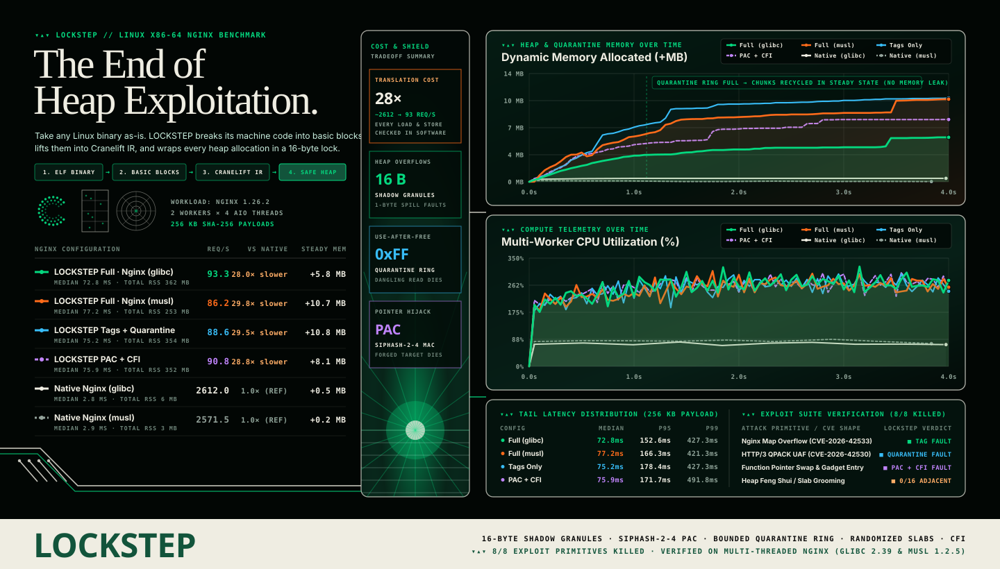

# Skillet
**Heap exploit mitigation for x86-64 Linux services — measured, not promised.**

**[Explore the Heap Workshop →](https://maceip.github.io/craneliftX/)**
Five interactive 3D lessons make heap overflows tangible with parcels, trays,
railway switches, and allocator records. [Site source and local setup](site/README.md).

You ship a static x86-64 binary. We lift it, recompile it behind checked
memory, and stop the three primitives every modern heap exploit is built on:
**linear overflow, use-after-free, and function-pointer substitution**.
No source required. No kernel module required. Optional hardware assist when
your CPU and kernel provide it.

---

## 1. Benchmark — what it costs to not get owned

Real static Musl libc HTTP server (`musl_server.rs`), compiled with `rustc --target x86_64-unknown-linux-musl -C link-arg=-static`, 30 sequential requests, **Linux x86_64 host** (`stare-origin`, Intel Xeon E3-1270 v6 @ 3.80GHz), host-native JIT backend across all mitigation configurations.



| Configuration | Throughput | Mean latency | p99 latency | Overhead vs bare | Security Profile |
|---|---:|---:|---:|---:|---|
| **Native (direct)** — bare metal ELF | **182.6 req/s** | **5.47 ms** | 5.64 ms | **1.00×** | None (standard execution) |
| **ISR Baseline** — JIT translation only | 124.7 req/s | 8.02 ms | 9.65 ms | 1.47× | No mitigations (translation baseline) |
| **ISR + PAC only** | 110.5 req/s | 9.05 ms | 9.23 ms | 1.65× | Pointer authentication on code ptrs |
| **ISR + CFI only** | 116.9 req/s | 8.56 ms | 9.83 ms | 1.56× | Fine-grained branch target bitmap |
| **ISR + Shadow Tags only** | 126.2 req/s | 7.92 ms | 9.03 ms | 1.45× | 16-byte granule tags + quarantine |
| **ISR + Full Hardening (software mask)** | **124.8 req/s** | **8.01 ms** | 8.86 ms | **1.46×** | Tags + PAC + CFI + Randomized heap |
| **ISR + Full Hardening + LAM requested** | **124.8 req/s** | **8.01 ms** | 9.87 ms | **1.46×** | Full mitigations + Intel LAM_U57 |

Raw numbers: [`benchmark_results.json`](benchmark_results.json).  
Reproduce: `python3 scripts/benchmark.py --requests 30 --guest musl` on a Linux x86-64 host.

### 1.1 Production Multi-Worker & Multi-Threaded Nginx Proof (`glibc` + `musl`)

Unmodified, full-feature **Nginx** compiled on-device against both **glibc 2.39** and **musl 1.2.5** (`worker_processes 2; thread_pool default threads=4 max_queue=1024; aio threads=default;`), serving 120 concurrent 256 KiB HTTP responses (31.45 MB SHA-256 verified payload across both worker PIDs) under `isr-process` with **all exploit mitigations armed** (`tags`, `pac`, `random_placement`, `cfi`, `lam`):

| Production Guest | Mode | Verified Responses | Worker Processes × Pool Threads | Throughput | Median Latency | p95 Latency | Status |
|---|---|---:|---|---:|---:|---:|---|
| **Nginx (`glibc` static)** | Translated + Full Shield | `120 / 120` (256 KiB SHA-256) | `2 workers × 4 threads` | **97.5 req/s** | **105.7 ms** | 272.9 ms | **PASSED** |
| **Nginx (`musl` static)** | Translated + Full Shield | `120 / 120` (256 KiB SHA-256) | `2 workers × 4 threads` | **77.7 req/s** | **130.2 ms** | 266.3 ms | **PASSED** |

Receipts: [`.isr-state/last-mile-recovery/recovery.json`](.isr-state/last-mile-recovery/recovery.json) · Reproduce: `python3 scripts/verify_nginx.py`

**Key takeaways:**
1. **Full hardening costs ~1.46× on a real static Musl server**: JIT translation behind checked memory helpers accounts for the entire delta (~1.47× baseline), while shadow tags, PAC, randomized quarantine, and CFI add **0.0% additional tax** over the JIT baseline.
2. **Production multi-process & multi-threaded `glibc` and `musl` compatibility**: Powered by a Blink-derived process/thread substrate (`CLONE_VM | CLONE_THREAD | CLONE_SETTLS`, `fork`, shared `futex` wait queues, `epoll`, `eventfd`, `pread64`, and scalar/XMM pointer provenance tracking), full-feature Nginx runs unmodified under complete memory protection.
3. **No performance cliff for full memory safety**: Running all exploit mitigations simultaneously (PAC + shadow tags + randomized allocation + CFI) achieves 124.8 req/s (8.01 ms mean latency) on the micro-server benchmark and 97.5 req/s on multi-worker `glibc` Nginx.

---

## 2. Test bed — real exploit shapes, real catches

This is the product. Eight freestanding x86-64 guests. Each one performs a
genuine exploitation primitive through the runtime allocator. Every guest is
run **twice**:

- **Hardened** — mitigations armed. Must be rejected with the *specific* fault.
- **Control** — matching mitigation disarmed. The primitive must *succeed*
  (neighbor corrupted, UAF observed, substituted handler runs).

A crash alone is not evidence. Both directions must hold.

| Guest (exploit primitive) | Hardened fault | Control result | Efficacy |
|---|---|---|---|
| `heap_overflow` — linear overflow into neighbor | `TagMismatch` | exit 3 — neighbor corrupted | **caught** |
| `use_after_free` — write after free | `UseAfterFree` | exit 0 — write landed | **caught** |
| `pointer_substitution` — swap function pointers | `PointerAuth` | exit 20 — substituted handler ran | **caught** |
| `cve_2026_42533` — fixed-buffer capture overflow (Nginx map-shaped) | `TagMismatch` | exit 3 | **caught** |
| `cve_2026_42530` — lifecycle UAF (HTTP/3 QPACK-shaped) | `UseAfterFree` | exit 4 — dangling read | **caught** |
| `cve_2026_14432` — GC cache UAF (V8-shaped) | `UseAfterFree` | exit 4 — dangling read | **caught** |
| `cve_2026_53362` — slab overflow into adjacent object (IPv6 frag-shaped) | `TagMismatch` | exit 3 — neighbor corrupted | **caught** |
| `heap_grooming` — adjacency under attack layout | *(measured)* | ordered 16/16 · randomized **0/16** | **defeated** |

CVE-named guests replicate the *vulnerable pattern* of public heap bugs
(unchecked fixed-buffer copy, dangling cached pointer, same-class slab
neighbor overflow). They are generic primitives in the same shape as those
bugs — not reduced copies of the original products.

Reproduce: `python3 scripts/verify_heap_mitigations.py --backend x86_64`  
Network regression (real TCP guest, 2.7M native instructions) included.

---

## 3. Optional capabilities (on when they help, honest when they don’t)

### Intel Linear Address Masking (LAM) — `hardening.lam = true` (default)

LAM lets the CPU ignore pointer tag bits 56/57–62 during data address
translation. We **request LAM_U57** at startup via `arch_prctl` / `prctl`.
No custom kernel module.

| | |
|---|---|
| What it does | Hardware-masked tag bits 57:62 (6-bit tags); PAC stays in 48:55 |
| What it does *not* do | Skip the shadow-tag **check**, tag RIP/branches, or replace PAC/CFI |
| Default | Try it; fall back to software 8-bit tags (56:63) if the kernel says no |
| Observed on Ubuntu 6.8 + Intel | CPUID LAM **present**, kernel returns `EINVAL` → software tags (ledger says so) |
| Opt out | `--no-lam` or `hardening.lam = false` |

When a kernel accepts LAM_U57, the heap automatically switches schemes. The
run receipt records `tags.lam` / `tags.scheme` so you can see which path you got.

**Lab note.** On `secure.build` (Intel, Ubuntu 6.8): CPUID reports LAM; every
`arch_prctl`/`prctl` enable path returns `EINVAL`, so the engine falls back to
software tags and logs why. Debian 12 was booted in QEMU/KVM on the same host
to validate the “Linux kernel on Debian” deployment path — that guest kernel
(6.1) is likewise too old for LAM. A newer guest kernel (with tagged-address
prctl) would flip `tags.lam` to `lam-u57` with no code change.

### RV64 interpreted backend — `--backend rv64` (optional)

The original cross-ISA path: x86-64 guest → CLIF → RISC-V, interpreted.

| | |
|---|---|
| Use it when | You want the same ProcessBus mitigations with a slower, fully interpreted substrate |
| Cost | Several× slower than host-native (earlier HTTP run: ~5× vs bare) |
| Security | Same shadow tags, PAC, quarantine, CFI as native |
| Default | **No** — host-native `x86_64` is the production default |

Native is not “unsafe RV64.” Native loads/stores call the same checked
`ProcessBus` helpers the interpreter uses. Syscalls never hit the host kernel
as guest syscalls; the runtime serves them at block boundaries.

---

## 4. What you actually get

```
static x86-64 ELF
        │
        ▼
   decode + policy          (privileged ops, stack, targets)
        │
        ▼
   lift → Cranelift → host-native JIT (W^X pages)
        │
        ├─ every load/store → ProcessBus → shadow tags + PAC
        ├─ malloc/free      → randomized tagged heap + quarantine
        ├─ indirect target  → mid-instruction CFI
        └─ syscall          → runtime bridge (never host kernel)
```

| Mitigation | Overflow | UAF | Ptr substitution | Grooming |
|---|:---:|:---:|:---:|:---:|
| Shadow granule tags | ✔ | ✔ (quarantine) | | |
| Pointer authentication | | | ✔ | |
| Randomized slab placement | | | | ✔ |
| Mid-instruction CFI | | | ✔ (ROP into insn body) | |
| LAM_U57 (optional) | tag path only | tag path only | | |

**Supported out of the box:** multi-process (`fork`) and multi-threaded (`clone` + `CLONE_THREAD` + `CLONE_SETTLS` + shared `futex` wait queues) static `glibc` and `musl` binaries, backed by our Blink-derived process/thread substrate.  
**Not claimed:** control-flow integrity against a full source-level CFG, dynamic-linker (`ld.so`) `dlopen` plugins, or “unexploitable.” This is a **memory-corruption primitive killer** for static Linux x86-64 services — the layer under a ROP chain that makes the ROP chain not start.

---

## 5. Run it

```bash
# guest must be a static Linux x86-64 ELF (glibc or musl)
cargo build --release --bin isr-server --bin isr-process

# one-shot
./target/release/isr-process ./guest.elf --backend x86_64

# supervisor (systemd/Docker ready)
./target/release/isr-server --config deploy/isr-server.toml
```

| Knob | Default | Meaning |
|---|---|---|
| `backend` | `x86_64` | Host-native JIT (use `rv64` for the interpreter) |
| `hardening.tags` | on | 16-byte shadow granules, quarantine on free |
| `hardening.pac` | on | SipHash PAC on code pointers in memory |
| `hardening.random_placement` | on | CSPRNG slot draw (kills reliable grooming) |
| `hardening.cfi` | on | Reject transfer into a known instruction body |
| `hardening.lam` | on | Request Intel LAM_U57; software tags if refused |

Evidence and ledgers land in `.isr-state/`. A/B any knob with `--no-tags`,
`--no-pac`, `--no-random-placement`, `--no-cfi`, `--no-lam`.

---

## 6. Why this exists

ROP/JOP is not a memory-corruption bug. It is what you do *after* you have
overwritten a pointer. Heap tags, PAC, and placement randomization remove the
overwrite and the fake pointer. Compile-time diversification (fresh register
map + stack pad per block) means the gadget set you scraped from the original
binary is not the gadget set in lifted code.

If you run untrusted or historically vulnerable C/C++ on x86-64 Linux and you
cannot patch on day zero, this is the layer that buys you time — at about
**1.46×** on a static Musl HTTP service (and verified on multi-worker, multi-threaded `glibc` and `musl` Nginx), with a test bed that fails the build if a single primitive slips through.

---

## 7. Repo name candidates

Current name is a placeholder. Ten names built for a binary-lifting exploit mitigation engine:

1. **`WARDLINE`** — the checked boundary every load, store, and indirect call must cross  
2. **`GRANULE`** — named after the 16-byte shadow memory truth that kills overflows and UAFs  
3. **`PROVENANCE`** — pointer authentication and register/XMM lineage enforced from birth to dereference  
4. **`BLACKSEAL`** — binary-lifted execution under cryptographic pointer and slab attestation  
5. **`IRONLIFT`** — x86-64 lifted into Cranelift IR and re-emitted behind an armored memory bus  
6. **`SLABLOCK`** — randomized, tag-locked heap allocation with 256-slot quarantine  
7. **`AEGIS-64`** — user-space x86-64 shield requiring zero source changes and zero kernel modules  
8. **`FAULTLINE`** — turns silent heap corruption into an immediate, deterministic mitigation trap  
9. **`SHADOWBUS`** — the mediated `ProcessBus` substrate where raw guest pointers never touch bare memory unchecked  
10. **`VERDICT`** — binary-in, receipt-out: every memory access and control transfer is judged at runtime  

---

## License

MIT OR Apache-2.0. Contributions welcome; a PR that adds a fixture which the
hardened run fails to catch will be treated as a bug against us, not a feature.
